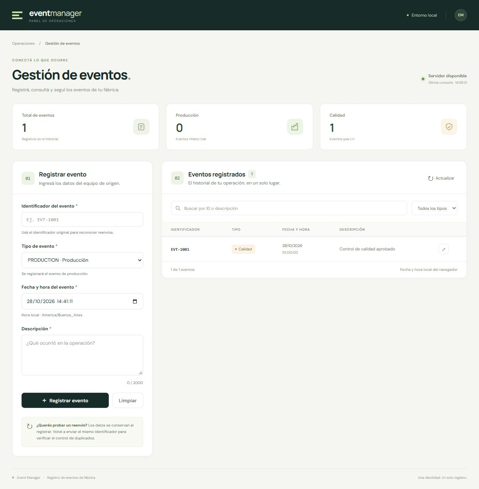
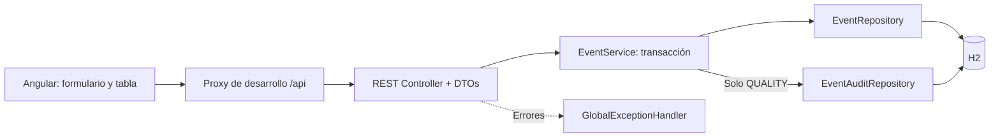

# Event Manager

Aplicación fullstack para registrar y consultar eventos enviados por equipos de una fábrica. Cada evento se identifica por su `eventId`: reenviarlo no crea un segundo evento ni una segunda auditoría.

**Java 17 · Spring Boot · Angular · H2**

| Tipo de evento | Comportamiento |
| --- | --- |
| `PRODUCTION` | Registra el evento. |
| `QUALITY` | Registra el evento y su auditoría en una misma transacción. |
| `eventId` ya registrado | Responde `409 Conflict` y conserva los registros existentes. |



## Contenido

- [Arranque local](#arranque-local)
- [Recorrido de evaluación](#recorrido-de-evaluación)
- [Contrato HTTP](#contrato-http)
- [Persistencia y verificación de auditorías](#persistencia-y-verificación-de-auditorías)
- [Arquitectura y decisiones](#arquitectura-y-decisiones)
- [Pruebas y compilación](#pruebas-y-compilación)
- [Correspondencia con la consigna](#correspondencia-con-la-consigna)
- [Alcance y mejoras futuras](#alcance-y-mejoras-futuras)
- [Resolución de problemas](#resolución-de-problemas)

## Arranque local

### Requisitos

| Herramienta | Requisito |
| --- | --- |
| Java | JDK 17 o 21, con `JAVA_HOME` configurado. El proyecto compila con destino Java 17. |
| Node.js | Angular 21 requiere Node `^20.19.0`, `^22.12.0` o una versión compatible de la rama 24. |
| npm | Se utiliza el `package-lock.json` incluido para instalar versiones reproducibles. |
| Maven | No requiere instalación global: se incluye Maven Wrapper. |
| Base de datos | No requiere instalación: H2 se ejecuta dentro del backend. |

La primera ejecución necesita acceso a Internet para descargar Maven y las dependencias. Las fuentes web del frontend tienen alternativas del sistema si no hay conexión.

```shell
git clone https://github.com/AlanFarias97/challenge-fujitsu.git
cd challenge-fujitsu
```

Los comandos del backend se ejecutan desde la raíz del repositorio, donde está `pom.xml`. Se necesitan dos terminales.

### Terminal 1: backend

Windows / PowerShell:

```powershell
.\mvnw.cmd spring-boot:run
```

Linux / macOS:

```shell
sh ./mvnw spring-boot:run
```

### Terminal 2: frontend

```shell
cd frontend
npm ci
npm start
```

| Recurso | Dirección |
| --- | --- |
| Interfaz Angular | http://127.0.0.1:4200 |
| API de eventos | http://localhost:8080/events |
| Consola de H2 | http://localhost:8080/h2-console |

Angular utiliza `/api/events`. El proxy de desarrollo reenvía esas solicitudes al backend como `/events`; no hace falta habilitar CORS en Java. La configuración está en [`frontend/proxy.conf.json`](frontend/proxy.conf.json).

## Recorrido de evaluación

Se puede comprobar la solución desde la interfaz o usando las solicitudes de [`docs/events.http`](docs/events.http). Este archivo es compatible con clientes que soportan el formato HTTP, como REST Client de VS Code; también se pueden copiar sus requests a Postman. No requiere autenticación ni scripts adicionales.

Usar identificadores nuevos para la primera ejecución. Si ya existen los de ejemplo, cambiar los identificadores en los requests y en las consultas SQL; el rechazo de un identificador existente es el comportamiento esperado.

| Paso | Acción | Resultado esperado |
| --- | --- | --- |
| 1 | Registrar `DEMO-PRODUCTION-001` como `PRODUCTION`. | `201`; un evento y ninguna auditoría para ese evento. |
| 2 | Registrar `DEMO-QUALITY-001` como `QUALITY`. | `201`; un evento y una auditoría vinculada. |
| 3 | Reenviar el mismo `QUALITY`, conservando su `eventId`. | `409`; sigue existiendo un solo evento y una sola auditoría. |
| 4 | Enviar ese mismo `eventId` con otros datos o tipo. | `409`; el evento original no se modifica. |
| 5 | Enviar una descripción vacía con otro identificador. | `400`; no se guarda el evento ni se genera auditoría. |
| 6 | Consultar `GET /events` o actualizar la tabla. | `200`; aparecen los registros válidos una sola vez. |
| 7 | Reiniciar el backend desde la misma carpeta y consultar nuevamente. | Los eventos y auditorías se conservan en H2 en archivo. |

El formulario conserva sus campos después del registro para facilitar el paso 3. La acción de reutilizar una fila vuelve a cargar sus datos. La búsqueda y el filtro por tipo operan sobre los eventos consultados.

La auditoría se verifica con SQL, como se explica a continuación; el contador de calidad del frontend cuenta eventos `QUALITY`, no consulta la tabla de auditorías.

## Contrato HTTP

### Registrar: `POST /events`

Encabezado: `Content-Type: application/json`.

```json
{
  "eventId": "DEMO-QUALITY-001",
  "timestamp": "2026-10-28T13:00:00Z",
  "eventType": "QUALITY",
  "description": "Control de calidad aprobado"
}
```

| Campo | Validación y significado |
| --- | --- |
| `eventId` | Obligatorio, no puede estar compuesto solo por espacios, máximo 100 caracteres. Identidad del evento en origen. |
| `timestamp` | Obligatorio; fecha/hora ISO 8601 con zona horaria, representada como `Instant`. |
| `eventType` | Obligatorio; admite exactamente `PRODUCTION` o `QUALITY`. |
| `description` | Obligatoria, no puede estar compuesta solo por espacios, máximo 2000 caracteres. |

Respuesta `201 Created`:

```json
{
  "id": 1,
  "eventId": "DEMO-QUALITY-001",
  "timestamp": "2026-10-28T13:00:00Z",
  "eventType": "QUALITY",
  "description": "Control de calidad aprobado"
}
```

`id` es un identificador interno generado por la base y su valor puede variar. No reemplaza al `eventId` externo.

Ejemplo desde PowerShell:

```powershell
$event = @{
    eventId = "DEMO-QUALITY-001"
    timestamp = "2026-10-28T13:00:00Z"
    eventType = "QUALITY"
    description = "Control de calidad aprobado"
}

$json = $event | ConvertTo-Json
Invoke-RestMethod -Method Post -Uri "http://localhost:8080/events" -ContentType "application/json" -Body $json
```

Repetir la última llamada prueba el duplicado. PowerShell mostrará el HTTP `409` como error del comando: es el rechazo esperado del servidor.

### Consultar: `GET /events`

Devuelve `200 OK` y un arreglo de eventos con el mismo contrato de respuesta. Si no hay registros, devuelve `[]`.

```powershell
Invoke-RestMethod -Uri "http://localhost:8080/events"
```

La API devuelve todos los registros, sin paginación ni un orden contractual. El frontend los ordena por ID interno descendente.

### Errores

Se utiliza `ProblemDetail` para centralizar las respuestas de error.

| Código | Situación |
| --- | --- |
| `400 Bad Request` | Campos inválidos, JSON mal formado, tipo desconocido o fecha no interpretable. |
| `409 Conflict` | `eventId` ya registrado, detectado por consulta previa o por la restricción única. |
| `500 Internal Server Error` | Fallo inesperado o error de integridad distinto de la duplicidad de `eventId`. Se registra el detalle en logs. |

Ejemplo de duplicado detectado en la consulta previa:

```json
{
  "status": 409,
  "title": "Evento duplicado",
  "detail": "El evento DEMO-QUALITY-001 ya fue registrado",
  "instance": "/events"
}
```

Si la base detecta el conflicto después de la consulta previa, `detail` indica: `Ya existe un evento registrado con ese eventId`. El código y el significado son los mismos.

Los errores de validación de campos incluyen una lista `errors`, por ejemplo `description: La descripción es obligatoria`. La interfaz muestra ese detalle. Los errores internos no exponen la traza ni las consultas SQL al cliente.

## Persistencia y verificación de auditorías

| Entorno | Base | Esquema |
| --- | --- | --- |
| Aplicación | `jdbc:h2:file:./data/event-manager` | Hibernate `update`. Conserva datos entre reinicios. |
| Tests de contexto/integración | H2 en memoria | Hibernate `create-drop`. |
| Tests de repositorio | Base embebida de `@DataJpaTest` | Las operaciones de cada test se revierten al finalizar. |

La carpeta `data/` se crea al iniciar la aplicación y queda fuera de Git. La URL es relativa al directorio de trabajo: iniciar siempre el backend desde la raíz del repositorio. No hay carga inicial de eventos; se registran desde la interfaz o la API. Las pruebas automatizadas no usan el archivo de la aplicación.

Para consultar auditorías, abrir la consola H2 con la aplicación ejecutándose:

```text
Driver Class: org.h2.Driver
JDBC URL: jdbc:h2:file:./data/event-manager
User Name: sa
Password: dejar vacío
```

Ejecutar [`docs/verification.sql`](docs/verification.sql), que contiene únicamente consultas de lectura. La consulta principal es:

```sql
SELECT
    e.event_id,
    e.event_type,
    COUNT(a.id) AS audit_count
FROM events e
LEFT JOIN event_audits a ON a.event_id = e.id
WHERE e.event_id IN ('DEMO-PRODUCTION-001', 'DEMO-QUALITY-001')
GROUP BY e.event_id, e.event_type
ORDER BY e.event_id;
```

Después del recorrido, `audit_count` debe ser **0 para PRODUCTION y 1 para QUALITY**, incluso después de reenviar el evento. Otros eventos que ya existan no alteran esta comprobación.

En `event_audits`, la columna `event_id` es una clave foránea al **ID interno** `events.id`. La identidad externa se almacena en `events.event_id`.

## Arquitectura y decisiones



```text
.
├── pom.xml / mvnw / mvnw.cmd
├── src/main/java/com/alan/challenge/event_manager/
│   ├── api/            Controllers, DTOs y respuestas de error
│   ├── application/    Coordinación de casos de uso y transacciones
│   ├── domain/         Entidades, tipos y excepción de duplicado
│   └── persistence/    Repositorios Spring Data JPA
├── src/main/resources/application.yaml
├── src/test/           Pruebas y configuración de H2 en memoria
├── frontend/           Angular, tests, proxy y documentación específica
└── docs/               Requests HTTP, consultas SQL y captura de la interfaz
```

### Identidad y política de reenvío

La deduplicación depende exclusivamente de `eventId`. No se genera otro identificador al reintentar ni se actualiza el evento original. El mismo identificador con otro tipo, fecha o descripción también se rechaza.

No se normalizan espacios ni mayúsculas: `EVT-1`, `evt-1` y ` EVT-1 ` son identificadores distintos bajo esta configuración. La política asume que el sistema de origen conserva la identidad que envía. No hay partición del identificador por equipo o fábrica.

Se eligió `409` para hacer explícito el reenvío al cliente. La garantía es que repetir la identidad no repite sus efectos; no se promete devolver la misma respuesta HTTP del primer envío.

### Duplicados y concurrencia

La consulta `existsByEventId` permite un rechazo temprano, pero no garantiza por sí sola la unicidad: dos solicitudes pueden consultar antes de que alguna guarde.

La garantía final es la restricción única `uk_events_event_id` en H2. Si ambas solicitudes intentan registrar la misma identidad, solo una puede confirmarse; la otra recibe `409`. El handler reconoce específicamente esa restricción. Otros errores de integridad no se presentan como duplicados.

La extracción del nombre de la restricción depende de Hibernate/H2 y está cubierta por una prueba con una violación real. Al migrar de motor hay que revisar esa traducción y probarla con el motor elegido.

### Atomicidad del evento y la auditoría

`EventService.register` define una transacción que contiene ambos guardados. Para `QUALITY`, un fallo al generar o guardar la auditoría revierte también el evento. Se evita así que un reintento encuentre un evento guardado sin la auditoría que le corresponde.

La auditoría contiene la referencia al evento y la fecha de su generación. No modela usuarios ni un historial de modificaciones: el alcance del ejercicio es registrar eventos y auditar los de calidad.

### Fecha/hora

El frontend ofrece una fecha/hora local editable, precargada al iniciar el formulario. Antes del envío la convierte a UTC. El backend requiere un valor ISO 8601 con zona horaria y utiliza `Instant`.

Por ejemplo, `2026-10-28T10:00:00-03:00` representa el mismo instante que `2026-10-28T13:00:00Z`. A diferencia del ejemplo sin zona de la consigna, este contrato exige hacer explícita la referencia temporal. No se restringen fechas pasadas o futuras porque la consigna no establece esa regla.

`timestamp` representa cuándo ocurrió el evento en origen; `auditedAt` se asigna en el servidor al generar la auditoría. H2 almacena estos campos con precisión de microsegundos, por lo que no se promete conservar nanosegundos arbitrarios de entrada. La tabla los muestra en la zona local del navegador.

### Tamaño y organización de la solución

Se eligió una aplicación por capas y una base embebida para que el ejercicio pueda ejecutarse sin infraestructura adicional. Las entidades de dominio son también entidades JPA; los DTOs separan el contrato HTTP del modelo persistido.

En Angular se separan formulario, listado, coordinación de pantalla y acceso HTTP. Se usan formularios reactivos, signals y detección de cambios OnPush. No se necesita una biblioteca adicional de estado para este alcance. Detalles en [`frontend/README.md`](frontend/README.md).

Los logs registran eventos confirmados, rechazos de duplicados y fallos internos. Esto facilita el diagnóstico local; no hay métricas ni trazas distribuidas implementadas.

## Pruebas y compilación

Desde la raíz, Windows / PowerShell:

```powershell
.\mvnw.cmd test
```

Linux / macOS:

```shell
sh ./mvnw test
```

Desde `frontend/`:

```shell
npm test
npm run build
```

La suite actual tiene **21 ejecuciones de tests de backend y 13 de frontend**, contando los casos parametrizados. Son comprobaciones funcionales, no una medición de porcentaje de cobertura.

| Suite | Qué verifica |
| --- | --- |
| `EventServiceTest` | Producción sin auditoría, calidad con auditoría y rechazo temprano de duplicados con mocks. |
| `EventRepositoryTest` | Guardado/lectura real y restricción única de `eventId`. |
| `EventIntegrationTest` | Contrato HTTP, validación, vínculo de auditoría, reenvíos, conflicto detectado por la base, rollback y dos solicitudes concurrentes. |
| `EventManagerApplicationTests` | Arranque del contexto de Spring. |
| Tests Angular | Contratos de HTTP, validación del formulario, conversión temporal, conservación de identidad, mensajes, consulta y recuperación ante errores. |

Los tests de integración del servicio no tienen una transacción externa de test: verifican el límite transaccional real del servicio. Para el caso de fallo de auditoría se utiliza un spy sobre el repositorio y se comprueba que no queda el evento guardado.

La prueba concurrente verifica que dos solicitudes obtengan `201` y `409` y dejen un único evento y auditoría. Otra prueba fuerza que la consulta previa no encuentre el duplicado para ejercitar de forma determinista el rechazo de la restricción única. No es una prueba de carga.

Durante los tests pueden aparecer errores SQL de unicidad y advertencias de Mockito: algunas excepciones se provocan deliberadamente. El resultado esperado es `BUILD SUCCESS`, con cero fallos y errores.

Para generar el JAR ejecutable, desde la raíz:

```powershell
.\mvnw.cmd package
java -jar target/event-manager-0.0.1-SNAPSHOT.jar
```

En Linux/macOS, usar `sh ./mvnw package`. El build de Angular se genera en `frontend/dist/frontend/browser/`. Actualmente backend y frontend se ejecutan por separado: el JAR no contiene Angular. El proxy se aplica solo a `npm start`; un despliegue del build requiere un servidor que sirva Angular y reenvíe `/api/events` a `/events` en el backend.

## Correspondencia con la consigna

| Requisito | Dónde comprobarlo |
| --- | --- |
| Registro y consulta fullstack | Formulario, tabla y endpoints `POST/GET /events`. |
| PRODUCTION y auditoría de QUALITY | Servicio, tablas H2 y consultas de `docs/verification.sql`. |
| Duplicados desde interfaz o API directa | Reenvío desde Angular y requests 3/4 de `docs/events.http`. |
| Validaciones y mensajes HTTP | DTO, handler y requests inválidos. |
| Fecha e identificador documentados | Secciones Contrato HTTP y Arquitectura y decisiones. |
| Ejecución de backend, frontend y pruebas | Arranque local y Pruebas y compilación. |
| Arquitectura, decisiones y mejoras | Arquitectura y decisiones, Alcance y mejoras futuras. |

## Alcance y mejoras futuras

La solución prioriza el funcionamiento demostrable y la claridad del código. Es una aplicación local sin autenticación, autorización, integración con equipos reales ni despliegue cloud. La consola H2 y su usuario sin contraseña pertenecen a ese entorno de evaluación.

Mejoras que se abordarían ante una necesidad real:

1. **Evolución del esquema:** migraciones con Flyway o Liquibase en lugar de `ddl-auto: update`.
2. **Persistencia de producción:** PostgreSQL y tests contra ese motor, por ejemplo con Testcontainers; revisar la traducción de restricciones y concurrencia.
3. **Volumen:** paginación, filtros y ordenamiento en API para evitar descargar todo el historial.
4. **Despliegue:** configurar reverse proxy, secretos y perfiles por entorno; restringir o deshabilitar la consola H2 fuera del entorno local.
5. **Operación:** métricas, identificadores de correlación y trazas según las necesidades del sistema.
6. **Automatización:** pipeline de CI y tests de navegador de extremo a extremo. Actualmente hay tests de backend e interfaz y comprobaciones manuales de integración.

Si los equipos necesitaran recepción asíncrona, reintentos desacoplados o grandes ráfagas, se evaluaría una cola junto con una estrategia de entrega e idempotencia explícita. El problema actual se resuelve de manera síncrona y transaccional.

## Resolución de problemas

| Síntoma | Acción |
| --- | --- |
| IntelliJ muestra `release version 5 not supported`, pero Maven compila. | Revisar la sincronización Maven y el nivel del módulo. En el entorno de desarrollo, IntelliJ 2025.2 fallaba al importar el Maven 3.10 del wrapper; usar el Maven incluido en el IDE resolvió la importación. El wrapper de terminal funciona. |
| npm 10 falla con `Cannot read properties of null (reading 'edgesOut')`. | Desde `frontend`, ejecutar `npm exec --yes --package=npm@11.6.2 -- npm ci`. Usa un instalador temporal sin actualizar npm global. |
| El frontend no puede conectar. | Comprobar que Spring Boot esté en el puerto 8080 y Angular se inicie con `npm start`. Si cambia el destino del proxy, reiniciar Angular. |
| H2 busca `~/test` o no muestra los datos esperados. | Usar exactamente la URL JDBC configurada e iniciar el backend desde la raíz del repositorio. La consola propone una URL de ejemplo que no corresponde a esta aplicación. |
| La base de datos está bloqueada. | Verificar que no haya otra instancia del backend o una herramienta externa abriendo el mismo archivo. Usar la consola incluida en la instancia activa. |
| La base está vacía después de ejecutar tests. | Los tests utilizan memoria y no cargan registros en la base de archivo de la aplicación. |
| El primer request de la demo devuelve `409`. | Ese identificador ya fue utilizado. Elegir uno nuevo para la creación y conservarlo en los reenvíos. |
